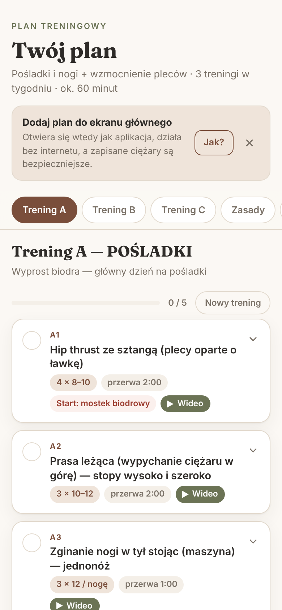

# Plan treningowy

Prosta aplikacja na telefon z planem treningowym na siłownię i do domu. Trzy treningi na siłownię robione na zmianę i jeden domowy, przy każdym ćwiczeniu opis techniki, lista najczęstszych błędów i krótki film. Do tego zapis ciężarów, minutnik przerw i reguła progresji.

Działa jak zwykła aplikacja: instaluje się na ekranie głównym, otwiera na pełnym ekranie i działa bez internetu. Nie ma kont, serwera ani reklam.



## Co potrafi

- **Trzy treningi A / B / C** — robione po kolei, bez przypisanych dni tygodnia.
- **Trening w domu** — krótka sesja na pośladki z kettlem i gumą, raz w tygodniu.
- **Opis każdego ćwiczenia** — ustawienie, ruch krok po kroku i czego unikać.
- **Filmy** — przycisk „Wideo” otwiera krótkie nagranie techniki (MuscleWiki).
- **Zapis wyników** — ciężar i powtórzenia, z podglądem dwóch ostatnich zapisów.
- **Minutnik przerwy** dopasowany do ćwiczenia, z wibracją na koniec.
- **Kopia zapasowa** — eksport i import danych do pliku (zakładka *Dane*).
- **Offline** — po pierwszym otwarciu wszystko działa bez zasięgu.

## Publikacja na GitHub Pages (bez instalowania czegokolwiek)

Wystarczy konto na [github.com](https://github.com) i przeglądarka.

1. **Utwórz repozytorium.** Na GitHubie kliknij **+** → **New repository**. Nazwa np. `plan-treningowy`, zaznacz **Public**, kliknij **Create repository**.
2. **Wgraj pliki.** Na stronie nowego repozytorium kliknij **uploading an existing file** (albo **Add file → Upload files**). Przeciągnij **całą zawartość** rozpakowanego folderu — `index.html` musi wylądować w głównym katalogu repozytorium, nie w podfolderze. Na dole kliknij **Commit changes**.
   - Plik `.nojekyll` jest ukryty i może się nie przeciągnąć. Nic się nie stanie — strona działa i bez niego.
3. **Włącz stronę.** W repozytorium wejdź w **Settings → Pages**. W sekcji **Build and deployment** ustaw **Source: Deploy from a branch**, gałąź **main**, folder **/ (root)** → **Save**.
4. **Poczekaj 1–2 minuty** i odśwież stronę ustawień. Na górze pojawi się adres w stylu:
   `https://twoja-nazwa.github.io/plan-treningowy/`

To jest link, który otwierasz na telefonie.

## Instalacja na telefonie

**iPhone:** otwórz link w **Safari** → przycisk **Udostępnij** (kwadrat ze strzałką) → **Do ekranu początkowego** → **Dodaj**.

**Android:** otwórz link w **Chrome** → menu **⋮** → **Zainstaluj aplikację** (albo **Dodaj do ekranu głównego**). Często Chrome sam zaproponuje instalację.

Od tej chwili plan uruchamiasz ikoną z ekranu głównego.

> Na iPhonie aplikacja z ekranu początkowego ma **osobną pamięć** od Safari. Jeśli coś było już zapisane w Safari, zrób kopię w zakładce *Dane* i wczytaj ją w zainstalowanej aplikacji.

## Dane i prywatność

- Wyniki, zaznaczenia i imię są zapisywane **tylko w pamięci przeglądarki na danym telefonie** (`localStorage`). Nic nie jest wysyłane na żaden serwer.
- Aplikacja nie ma analityki ani śledzenia. Czcionki są w repozytorium, więc strona nie łączy się z Google Fonts.
- Jedyne połączenia zewnętrzne to linki do filmów — otwierają się dopiero po kliknięciu.
- **Rób kopię zapasową** (zakładka *Dane* → *Zapisz kopię*) co kilka tygodni i zawsze przed zmianą telefonu. Usunięcie danych przeglądarki albo aplikacji kasuje wyniki.
- Imię wpisujesz w aplikacji, więc nie trafia do publicznego kodu.

## Jak zmienić plan

Cała treść jest w jednym pliku: **`plan.js`**. Można go edytować bezpośrednio na GitHubie (otwórz plik → ikona ołówka → **Commit changes**).

- `name`, `sets`, `rest` — nazwa, serie × powtórzenia, przerwa w sekundach.
- `setup`, `steps`, `avoid` — ustawienie, kroki, błędy.
- `video` — końcówka adresu z [musclewiki.com](https://musclewiki.com). Np. dla `musclewiki.com/exercise/barbell-hip-thrust` wpisujesz `barbell-hip-thrust`.
- `id` — **nie zmieniaj go** w istniejącym ćwiczeniu, bo po nim zapisywane są wyniki. Nowemu ćwiczeniu nadaj nowy, unikalny `id`.

Po zapisaniu zmian na GitHubie nowa wersja pojawia się na telefonie **przy drugim otwarciu aplikacji** — za pierwszym razem pobiera się w tle.

Jeśli dodajesz do projektu **nowy plik** (np. obrazek), dopisz go do listy `ASSETS` w `sw.js` i zmień numer w `CACHE` (np. `v1` → `v2`), żeby działał offline.

## Uruchomienie lokalnie

Tryb offline działa tylko przez `http(s)`, nie z pliku otwartego dwuklikiem:

```bash
python3 -m http.server 8000
# potem otwórz http://localhost:8000
```

## Struktura

```
index.html            wygląd (HTML + CSS)
plan.js               treść planu — tu edytujesz ćwiczenia
app.js                logika: zapis, minutnik, eksport/import, instalacja
sw.js                 działanie offline
manifest.webmanifest  nazwa i ikony aplikacji
icons/                ikony
fonts/                czcionki Inter i Fraunces (licencja OFL)
```

## Licencje i uwagi

- Kod: licencja **MIT** (plik `LICENSE`).
- Czcionki: Inter i Fraunces, licencja **SIL Open Font License 1.1** (`fonts/`).
- Filmy należą do [MuscleWiki](https://musclewiki.com) — aplikacja tylko do nich linkuje i nie zawiera ich kopii.
- Plan został ułożony dla konkretnej osoby i jej sprzętu. To nie jest porada medyczna ani zamiennik trenera — przy bólu lub urazie skonsultuj się ze specjalistą.
